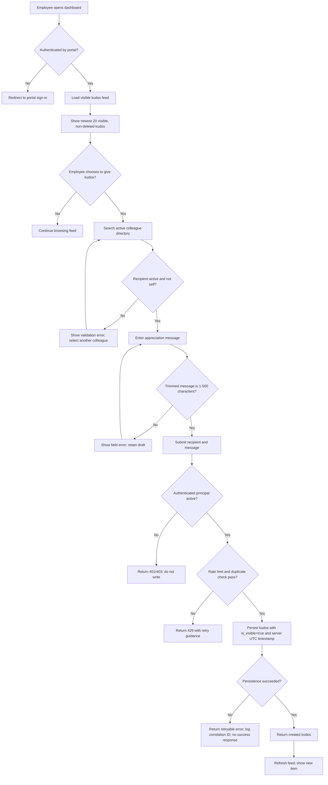
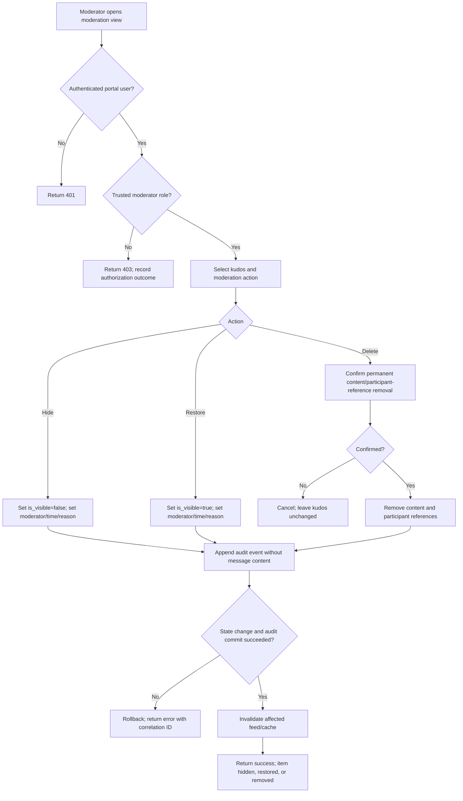

# Kudos System Process Flow

**Status:** Approved for the local prototype — follows [SPECIFICATION.md](./SPECIFICATION.md).

## Employee gives kudos and views the feed

## Moderator hides, restores, or deletes kudos

## Key system boundaries and checks

1. The portal identity provider authenticates employees and supplies trusted identity/role claims.
2. The employee directory is the authority for active status and display names.
3. The Kudos API derives sender/moderator identities server-side and enforces all validation and authorization.
4. The database stores kudos state and append-only moderation audit events.
5. Feed queries return only visible, non-deleted items and are cursor-paginated.
6. Logs and moderation audit events must not include kudos message content.

## Implementation sequence

1. Approve this flow and the accompanying specification; confirm host portal contracts/policies.
2. Implement schema, API flows, and tests.
3. Implement accessible user and moderator interfaces against the approved API.
4. Run end-to-end/security tests and deployment readiness checks.
5. Deploy through the host portal pipeline and monitor.
